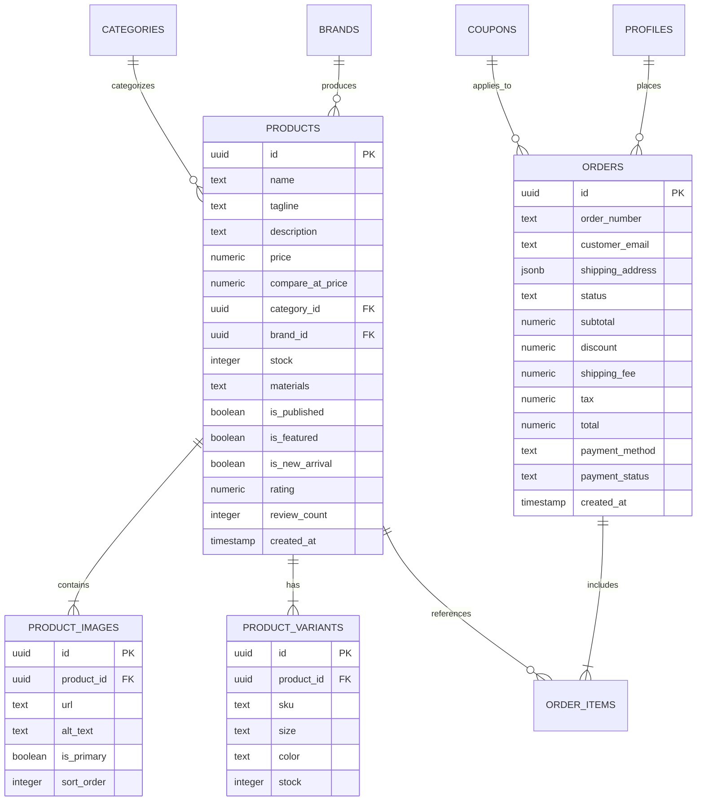

<div align="center">

# ONESTOP BY MAJID
### *Curated Living • Minimalist E-Commerce Platform & Privileged Admin Atelier*

[](https://onestop-by-majid.netlify.app)
[](https://onestop-by-majid.netlify.app/control-x7k2)
[](https://react.dev/)
[](https://www.typescriptlang.org/)
[](https://vitejs.dev/)
[](https://tailwindcss.com/)
[](https://supabase.com/)

---

<p align="center">
  A high-end, editorial e-commerce platform built with an uncompromising focus on tactile minimalism, brutalist aesthetics, rapid state persistence, and robust administrative security.
</p>

[Explore Storefront](https://onestop-by-majid.netlify.app) • [Administrative Portal](https://onestop-by-majid.netlify.app/control-x7k2) • [Database Schema](#-database-architecture) • [Getting Started](#-getting-started)

</div>

---

## 🌟 Executive Overview

**Onestop by Majid** is designed for modern lifestyle brands requiring sophisticated aesthetic appeal combined with production-grade backend architecture. It features a client-facing storefront offering curated artifacts, live multi-variant purchasing, and an administrative console protected behind cryptographic secret routing, automated rate limiting, and Supabase cloud infrastructure.

All monetary valuations and pricing are formatted natively in **RS (PKR)** across all customer flows and backend ledger operations.

---

## 🚀 Key Features

### 🛍️ Client Experience (Storefront)
- **Minimalist Editorial Gallery:** High-impact typography, dark/light theme switching, and curated collection showcases.
- **Dynamic Catalog Discovery:** Real-time search modal, category filtering, and price sliders with instant visual updates.
- **Rich Product Detail Modal:** Multi-image gallery with image zoom, variant selection (size/color/stock), customer reviews, and product specifications.
- **Frictionless Shopping Bag:** Slide-out slide-over cart drawer with real-time subtotal, coupon code application, tax estimation, and free shipping progress meter.
- **Multi-Step Checkout:** Form validation with Zod, express vs. standard shipping tiers, customer address collection, and payment mode toggle.
- **Patron Wishlist:** Persistent local wishlist drawer for bookmarking favorite artifacts.
- **Order Confirmation & Receipts:** Instant digital order summary, fulfillment pipeline tracker, and printable invoice generator.

### 🛡️ Administrative Console (Privileged Atelier)
- **Obfuscated Route Access:** Admin panel is strictly mapped to the secret path `/control-x7k2` or shortcut hotkey (`Ctrl + Shift + A`).
- **Brute-Force Lockout Defense:** Built-in rate limiting locks the console after 5 consecutive failed authentication attempts.
- **Catalog & Inventory Control:**
  - Create and edit products with multi-image direct upload to **Supabase Storage**.
  - Drag-and-drop or batch file selector with cover image allocation.
  - Variant management (SKU, size, color, stock allocations).
  - Quick restock triggers and draft/published visibility toggles.
- **Order Pipeline Tracking:** Real-time order queue inspection, patron contact records, destination details, tracking number assignment, and status dispatch transitions (`Pending` ➔ `Confirmed` ➔ `Shipped` ➔ `Delivered`).
- **Customer CRM Directory:** Customer database with telephone records, shipping addresses, order volume, and lifetime value calculation.
- **Promotion & Coupon Engine:** Create percentage or fixed (RS) promo vouchers with minimum spend requirements and expiration timers.
- **Security Audit Logs:** Immutable timestamped trail capturing every administrative event, status change, login attempt, and IP record.
- **Mobile-Responsive Architecture:** Native touch-friendly horizontal tab navigation and responsive data tables designed for on-the-go inventory management.

---

## 🛠️ Technology Stack

| Layer | Technologies |
| :--- | :--- |
| **Frontend Framework** | [React 19](https://react.dev/) + [TypeScript](https://www.typescriptlang.org/) |
| **Bundler & Build Tool** | [Vite 8](https://vitejs.dev/) |
| **Styling & Design System** | [Tailwind CSS](https://tailwindcss.com/) + Custom Typography + Lucide React Icons |
| **State Management** | [Zustand](https://github.com/pmndrs/zustand) |
| **Backend & Cloud Database** | [Supabase](https://supabase.com/) (PostgreSQL 15) |
| **Media Storage** | Supabase Storage Bucket (`product-images`) via Public CDN |
| **Schema Validation** | [Zod](https://zod.dev/) |
| **Hosting & CI/CD** | [Netlify](https://www.netlify.com/) (Continuous Deployment & SPA Rewrites) |

---

## 🗄️ Database Architecture

The application communicates directly with Supabase via `@supabase/supabase-js`. The relational schema includes:



Full SQL migrations and seed scripts are located at [`supabase/migrations/20240101000000_init_ecommerce.sql`](supabase/migrations/20240101000000_init_ecommerce.sql).

---

## 💻 Getting Started

### Prerequisites
- [Node.js](https://nodejs.org/) (version 18.0 or higher)
- [npm](https://www.npmjs.com/) or [bun](https://bun.sh/)
- A free [Supabase](https://supabase.com/) account

### 1. Clone the Repository
```bash
git clone https://github.com/WaliMuhammadid/onestop-by-majid.git
cd onestop-by-majid
```

### 2. Install Dependencies
```bash
npm install
```

### 3. Configure Environment Variables
Copy the example environment template:
```bash
cp .env.example .env
```

Open `.env` and fill in your Supabase project credentials:
```env
VITE_SUPABASE_URL="https://your-project.supabase.co"
VITE_SUPABASE_ANON_KEY="your-anon-publishable-key"

# Administrative Security
ADMIN_SECRET_PATH="/control-x7k2"
ADMIN_DEFAULT_EMAIL="admin@onestopbymajid.com"
```

### 4. Run Development Server
```bash
npm run dev
```
The application will launch at `http://localhost:3000`.

---

## 🔒 Administrative Console Access

To prevent public exposure, the administrative console does not appear in public navigation:

1. **Direct URL:** Navigate to `http://localhost:3000/control-x7k2` *(or `https://onestop-by-majid.netlify.app/control-x7k2` in production)*.
2. **Keyboard Shortcut:** Press **`Ctrl + Shift + A`** *(or `Cmd + Shift + A` on Mac)* from anywhere on the site to trigger the authentication modal.

---

## 📦 Production Build & Deployment

Build optimized static assets:
```bash
npm run build
```

This generates production artifacts in the `dist/` directory.

### Netlify Deployment
The project includes a ready-to-use [`netlify.toml`](netlify.toml) and [`public/_redirects`](public/_redirects) for Single Page Application (SPA) routing:
- **Build Command:** `npm run build`
- **Publish Directory:** `dist`
- **Redirects:** Single-page rewrites (`/* -> /index.html 200`) prevent 404 errors on deep linking or route reloads.

---

## 📄 License & Credits

Developed with precision and reverence for high craft by **Onestop by Majid**.

Crafted for **Wali Muhammad** &bull; Distributed under the [MIT License](LICENSE).
